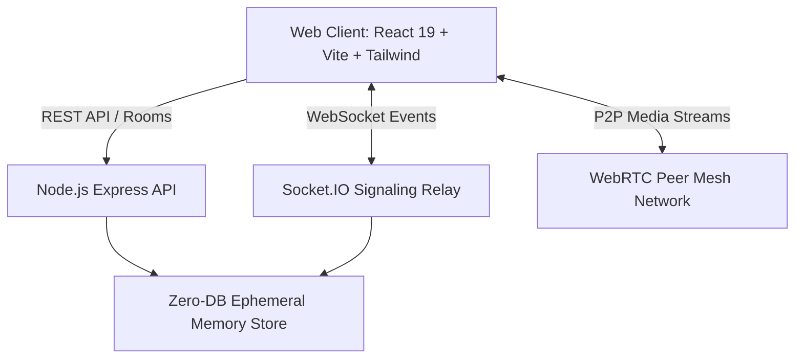

# Musica Platform 📡🎵

> **Real-Time Social Audio, Screen Sharing & Synchronized Watch Party Platform**

[](https://musica-apvs.vercel.app)
[](https://www.typescriptlang.org/)
[](https://nodejs.org/)
[](https://webrtc.org/)
[](https://socket.io/)
[](https://www.docker.com/)

---

## 🌟 Executive Overview

**Musica** is an interactive, low-latency social listening and broadcasting platform that lets users create ephemeral virtual listening rooms, synchronize audio streams, broadcast high-definition screen video, and chat with friends in real time.

Built from the ground up on a **Zero-Database (Zero-DB) Memory Architecture**, Musica achieves sub-second room instantiation without persistent database bottlenecks, keeping all active state ephemeral and memory-efficient.

---

## 🏗️ Architecture & Topology

Musica is structured as an npm workspaces monorepo:



```text
musica/
├── shared/            # Universal TypeScript contracts, error hierarchies, schemas
│   ├── src/types.ts   # Room, Participant, ChatMessage, YouTubeSyncPayload
│   └── src/events.ts  # Universal SOCKET_EVENTS dictionary
├── server/            # Node.js + Express + Socket.IO Signaling Server
│   ├── src/services/  # Ephemeral StorageService, RoomService, ParticipantService
│   └── src/socket/    # Signaling Relay & WebRTC Coordination
├── client/            # Modern React 19 + Vite 8 + Tailwind CSS v4 Frontend
│   ├── src/components/# Audio controls, room grids, screen-share viewport
│   └── src/hooks/     # useWebRTC, useSocket, useRoomState
└── docker/            # Multi-stage production container configurations
```

---

## ✨ Key Features

- **⚡ Zero-DB Ephemeral Rooms:** Instant 4-character room codes (`#ABCD`) stored in high-performance memory structures with automatic garbage collection on host departure.
- **🖥️ WebRTC Screen & Audio Broadcast:** Low-latency P2P media streaming with adaptive bitrate fallbacks and screen audio pass-through.
- **🎧 Synchronized Media Player:** Frame-accurate YouTube and local audio synchronization with host play/pause/seek authority.
- **🛡️ Role-Based Access Control (RBAC):** Host, Co-Host/DJ, and Listener permission tiers with granular moderation (mute, kick, transfer host).
- **💬 Real-Time Chat & Emoji Reactions:** Ephemeral messaging pipeline routed via Socket.IO with zero disk persistence for privacy.

---

## 🚀 Quick Start Guide

### Prerequisites
- **Node.js** (v18.0.0 or higher)
- **npm** (v9.0.0 or higher)

### Installation & Local Development

1. **Clone the repository:**
   ```bash
   git clone https://github.com/PackhunterforCynic/musica.git
   cd musica
   ```

2. **Install all workspace dependencies:**
   ```bash
   npm install
   ```

3. **Launch the development environment (concurrent server + client):**
   ```bash
   npm run dev
   ```

4. **Access the application:**
   - Client: `http://localhost:5173`
   - Signaling Server: `http://localhost:3000`

---

## 🐳 Docker Deployment

Run the complete platform via Docker Compose:

```bash
docker-compose up --build -d
```

---

## 👨‍💻 Author

**Robinson J. ([@PackhunterforCynic](https://github.com/PackhunterforCynic))**  
*Full-Stack Engineer & Real-Time Systems Specialist*  
Portfolio: [robinsonj.vercel.app](https://robinsonj.vercel.app) • LinkedIn: [linkedin.com/in/robinson-mj](https://linkedin.com/in/robinson-mj)

