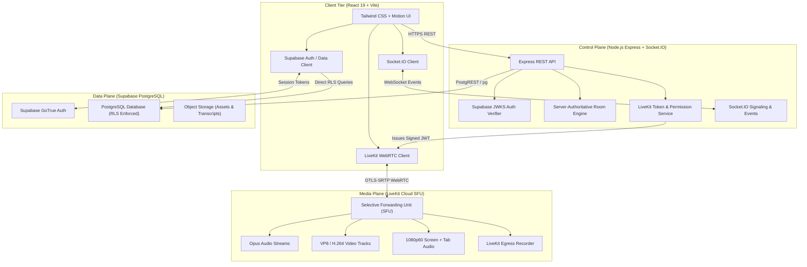
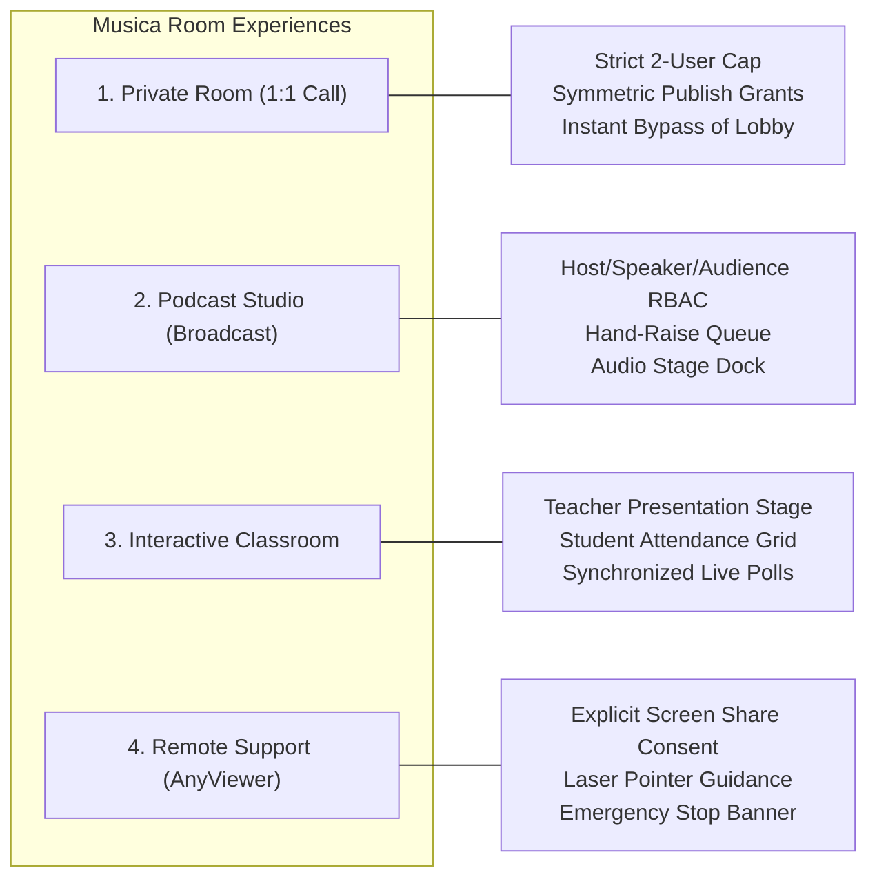
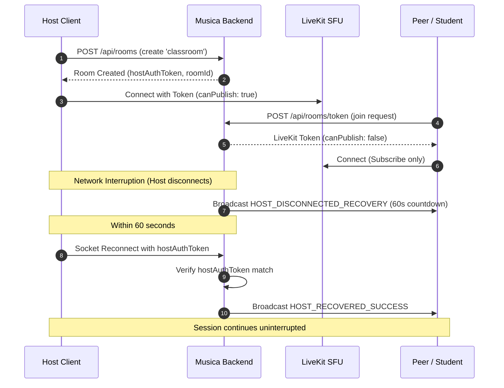

# Musica Architecture Specification

> **Musica 1.0 & 2.0 Real-Time Collaboration & Streaming Platform**  
> Three-Tier Decoupled Architecture: Media Plane, Control Plane, and Data Plane.

---

## 1. Executive Architecture Overview

Musica is engineered as a unified real-time collaboration platform featuring four specialized room experiences powered by a common, decoupled infrastructure. Rather than maintaining disparate applications, Musica abstracts real-time communication into three autonomous planes:

---

## 2. Three-Tier Architectural Topology

### 2.1 Media Plane — LiveKit Cloud SFU
- **Purpose**: High-throughput, low-latency audio/video packet routing and screen media transport.
- **Protocol**: WebRTC via DTLS-SRTP, ICE (STUN/TURN fallback).
- **Architecture**: Selective Forwarding Unit (SFU). Instead of a mesh where bandwidth scales $O(N^2)$, the client publishes one stream to the SFU, which duplicates and forwards tracks down to subscribers with adaptive bitrate simulcast ($O(N)$).
- **Capabilities**: Audio processing (echo cancellation, noise suppression), dynamic bitrate adaptation, track publication control, and composite room recording via LiveKit Egress.

### 2.2 Control Plane — Musica Express Backend
- **Purpose**: Identity verification, room admission control, permission management, token issuance, and state synchronization.
- **Protocol**: HTTPS REST (`/api/*`) and WebSocket (`Socket.IO`).
- **Key Services**:
  - `RoomService`: In-memory authoritative room store, lifecycle timers, and capacity enforcement.
  - `LiveKitService`: Server-side generation of cryptographically signed LiveKit Access Tokens with granular track publication permissions.
  - `SupabaseService`: JWKS asymmetric token verification and database integration.
  - `SocketService`: Real-time signaling, room locking, host failover recovery, and event broadcasting.

### 2.3 Data Plane — Supabase PostgreSQL
- **Purpose**: Durable data persistence, user accounts, audit logging, and authorization boundary.
- **Security**: PostgreSQL Row-Level Security (RLS) guarantees that authenticated clients cannot access or modify records belonging to other tenants.
- **Storage**: User profiles, room archives, attendance rosters, chat transcripts, and recording metadata.

---

## 3. Four Core Room Experiences

### 1. Private Room
- **Capacity**: Strictly capped at 2 participants (1 host, 1 peer).
- **Access Pattern**: Automatic lobby admission on token validation to prevent deadlocks.
- **Media**: Full duplex audio/video and screen sharing with screen audio.
- **Telemetry**: Live call timer and WebRTC connection quality indicators.

### 2. Podcast Studio
- **Capacity**: Scalable up to 200 participants.
- **Roles**: Host, Co-Host, Speaker, Listener.
- **Stage Dynamics**: Visual separation between on-stage speakers and audience gallery.
- **Moderation**: Listeners request to speak via `raise-hand`; hosts review and promote with `PODCAST_PROMOTE_SPEAKER`.

### 3. Interactive Classroom
- **Capacity**: Scalable up to 100 students per instructor.
- **Stage Modes**: Tabbed stage toggling between Live Screen Presentation, Collaborative Whiteboard, and Lecture Notes.
- **Interactivity**: Synchronized multiple-choice quizzes with live result aggregation and question hand-raising queue.

### 4. Remote Support
- **Capacity**: Strictly 2 participants (1 Customer, 1 Support Technician).
- **Security Model**: Web-based viewer with zero OS control injection. Technician guides customer using synchronized SVG laser pointer annotations (`xRatio`, `yRatio`).
- **Safety**: Persistent customer banner ("You are sharing your screen") with instant one-click termination.

---

## 4. Room Lifecycle & Host Reconnection Engine

1. **Host Disconnect Event**: When the host socket drops, the server places the room into `recovering` status and initiates a strict 60-second recovery timer.
2. **Graceful Reconnection**: The returning host presents their initial `hostAuthToken`. Upon verification, host privileges are restored immediately.
3. **Grace Period Expiry**: If the timer expires without host recovery, `RoomService` terminates the session, invalidates LiveKit tokens, and broadcasts `ROOM_ENDED_BY_HOST`.

---

## 5. Technology Stack Summary

| Layer | Technology | Primary Function |
|---|---|---|
| Frontend Framework | React 19 + TypeScript + Vite | SPA Rendering, Real-Time UI |
| Styling & Theme | Tailwind CSS v4 + Tokens CSS | Studio Dark Palette (`#0B1020`) |
| Animations | Motion for React (`framer-motion`) | Route transitions, micro-interactions |
| Media Engine | LiveKit Cloud SFU + LiveKit React SDK | WebRTC Audio/Video/Screen Transport |
| Control API | Node.js + Express + TypeScript | REST API & RBAC Token Service |
| Real-Time Signaling | Socket.IO | Room events, polls, laser annotations |
| Persistence & Auth | Supabase (PostgreSQL + GoTrue Auth) | User identity, migrations, RLS policies |
| Deployment | Vercel (Client) + Render (Server) | Edge CDN + Containerized API Hosting |
