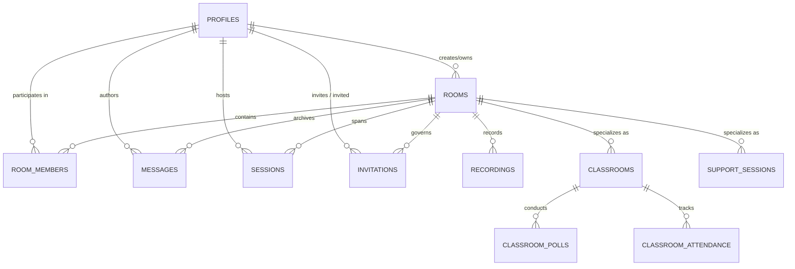

# Musica Database & Supabase Specification

> **Musica 1.0 & 2.0 Persistence Layer**  
> PostgreSQL Schema Catalog, Row-Level Security (RLS) Policies, and Data Models.

---

## 1. Schema Architecture & Entity Relationships

Musica uses Supabase PostgreSQL as its authoritative data plane. All database migrations are located in `supabase/migrations/` and apply declarative table schemas, foreign key integrity constraints, and Row-Level Security (RLS) policies.



---

## 2. Table Catalog Reference

### 2.1 `profiles` (`001_profiles.sql`)
Extends `auth.users` with application-specific user identity and metadata.
- `id` (`UUID`, PK, references `auth.users(id) ON DELETE CASCADE`)
- `username` (`TEXT`, UNIQUE, NOT NULL)
- `display_name` (`TEXT`, NOT NULL)
- `avatar_url` (`TEXT`)
- `bio` (`TEXT`)
- `created_at` (`TIMESTAMPTZ`, DEFAULT `NOW()`)
- `updated_at` (`TIMESTAMPTZ`, DEFAULT `NOW()`)

### 2.2 `rooms` (`002_rooms.sql`)
Represents room configurations, metadata, and persistent state.
- `id` (`UUID`, PK, DEFAULT `gen_random_uuid()`)
- `code` (`VARCHAR(16)`, UNIQUE, NOT NULL) - Friendly alphanumeric room code
- `name` (`TEXT`, NOT NULL)
- `description` (`TEXT`)
- `cover_image_url` (`TEXT`)
- `type` (`room_type_enum`, NOT NULL) - `'private'`, `'podcast'`, `'classroom'`, `'remote_support'`, `'studio'`, etc.
- `status` (`room_status_enum`, DEFAULT `'waiting'`) - `'waiting'`, `'live'`, `'ended'`
- `owner_id` (`UUID`, references `profiles(id)`)
- `max_participants` (`INT`, DEFAULT 50)
- `is_private` (`BOOLEAN`, DEFAULT `false`)
- `config` (`JSONB`, DEFAULT `{}`) - Dynamic room options
- `created_at` (`TIMESTAMPTZ`)

### 2.3 `room_members` (`003_room_members.sql`)
Tracks historical and current participant associations with rooms.
- `id` (`UUID`, PK)
- `room_id` (`UUID`, references `rooms(id) ON DELETE CASCADE`)
- `user_id` (`UUID`, references `profiles(id) ON DELETE CASCADE`)
- `role` (`room_role_enum`) - `'host'`, `'co_host'`, `'speaker'`, `'student'`, `'listener'`, etc.
- `status` (`TEXT`, DEFAULT `'active'`)
- `joined_at` (`TIMESTAMPTZ`)
- `left_at` (`TIMESTAMPTZ`)

### 2.4 `invitations` (`004_invitations.sql`)
Manages single-use or multi-use room invite tokens.
- `id` (`UUID`, PK)
- `room_id` (`UUID`, references `rooms(id) ON DELETE CASCADE`)
- `inviter_id` (`UUID`, references `profiles(id)`)
- `invite_code` (`TEXT`, UNIQUE, NOT NULL)
- `role` (`room_role_enum`, DEFAULT `'audience'`)
- `max_uses` (`INT`, DEFAULT 1)
- `uses_count` (`INT`, DEFAULT 0)
- `expires_at` (`TIMESTAMPTZ`)

### 2.5 `messages` (`005_messages.sql`)
Stores chat history, system announcements, and threaded room messages.
- `id` (`UUID`, PK)
- `room_id` (`UUID`, references `rooms(id) ON DELETE CASCADE`)
- `sender_id` (`UUID`, references `profiles(id)`)
- `content` (`TEXT`, NOT NULL)
- `type` (`TEXT`, DEFAULT `'text'`) - `'text'`, `'system'`, `'poll'`
- `created_at` (`TIMESTAMPTZ`)

### 2.6 `sessions` (`006_sessions.sql`)
Tracks real-time session runtimes, peak attendance, and duration telemetry.
- `id` (`UUID`, PK)
- `room_id` (`UUID`, references `rooms(id) ON DELETE CASCADE`)
- `started_at` (`TIMESTAMPTZ`, NOT NULL)
- `ended_at` (`TIMESTAMPTZ`)
- `peak_participants` (`INT`, DEFAULT 0)
- `total_broadcast_seconds` (`INT`, DEFAULT 0)

### 2.7 `recordings` (`007_recordings.sql`)
Maintains metadata for LiveKit Egress recordings stored in Supabase Storage or S3.
- `id` (`UUID`, PK)
- `room_id` (`UUID`, references `rooms(id)`)
- `session_id` (`UUID`, references `sessions(id)`)
- `file_url` (`TEXT`, NOT NULL)
- `duration_seconds` (`INT`)
- `file_size_bytes` (`BIGINT`)
- `status` (`TEXT`) - `'processing'`, `'completed'`, `'failed'`

### 2.8 `classrooms` & Sub-Tables (`008_classrooms.sql`)
Specialized models for education sessions.
- `classrooms`: Linked to `rooms(id)` with `curriculum`, `active_notes`, `whiteboard_data`.
- `classroom_polls`: Dynamic polls (`question`, `options`, `is_active`).
- `classroom_poll_votes`: Individual student votes for integrity.
- `classroom_attendance`: Check-in, check-out, and total attentiveness duration.

### 2.9 `support_sessions` (`009_support_sessions.sql`)
Specialized models for AnyViewer-style remote technical assistance.
- `id` (`UUID`, PK)
- `room_id` (`UUID`, references `rooms(id)`)
- `technician_id` (`UUID`, references `profiles(id)`)
- `customer_id` (`UUID`, references `profiles(id)`)
- `pin_code` (`VARCHAR(6)`, NOT NULL)
- `consent_given` (`BOOLEAN`, DEFAULT `false`)
- `annotations_count` (`INT`, DEFAULT 0)
- `status` (`TEXT`) - `'pending'`, `'active'`, `'terminated'`

---

## 3. Row-Level Security (RLS) Policy Audit

Every table has `ALTER TABLE ... ENABLE ROW LEVEL SECURITY;` applied.

| Table | Operation | Policy Rule |
|---|---|---|
| `profiles` | SELECT | Publicly readable for all authenticated users |
| `profiles` | UPDATE | Only user with matching `auth.uid() = id` |
| `rooms` | SELECT | Public rooms readable by all; private rooms restricted to members |
| `rooms` | INSERT | Authenticated users can create rooms where `owner_id = auth.uid()` |
| `rooms` | UPDATE | Only room owner (`owner_id = auth.uid()`) |
| `messages` | SELECT | Accessible only to active participants of that `room_id` |
| `messages` | INSERT | Sender must match `auth.uid()` and belong to the room |
| `support_sessions` | ALL | Restricted exclusively to `customer_id = auth.uid()` or `technician_id = auth.uid()` |

---

## 4. Migration Execution & Seed Procedure

To apply migrations against your Supabase project:

```bash
# Push migrations to remote database
npx supabase db push

# Or apply manually via Supabase SQL Editor
# (Execute 001_profiles.sql through 009_support_sessions.sql sequentially)

# Seed initial test fixtures
npx supabase db execute --file supabase/seed.sql
```
