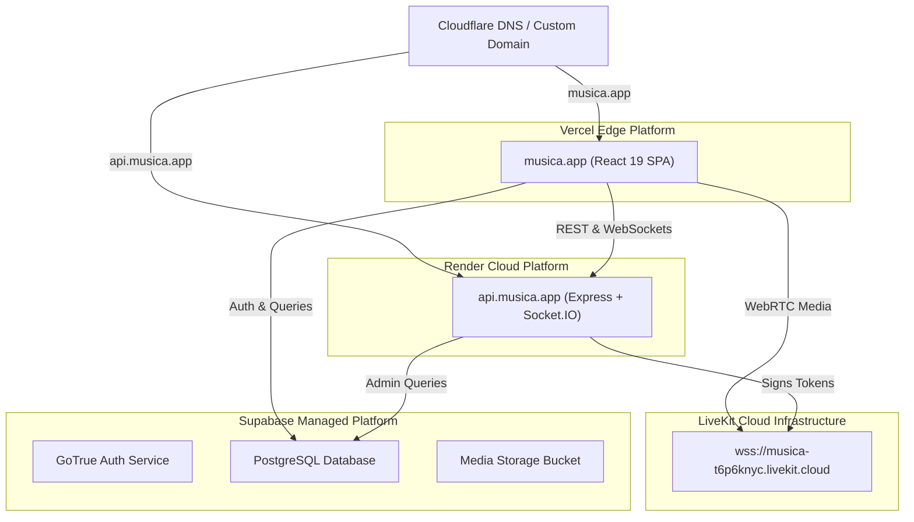

# Musica Production Deployment Guide

> **Multi-Cloud Deployment Architecture**  
> Vercel (Client) + Render (Server) + LiveKit Cloud (Media) + Supabase (Database).

---

## 1. Production Architecture Overview

Musica is deployed across specialized cloud infrastructure for optimal performance and uptime:



---

## 2. Environment Variables Matrix

| Variable Name | Required In | Production Example Value | Purpose |
|---|---|---|---|
| `PORT` | Render | `10000` | Backend listening port |
| `NODE_ENV` | Render | `production` | Enables production optimizations |
| `CLIENT_URL` | Render | `https://musica.app` | CORS allowed origin |
| `LIVEKIT_URL` | Client & Render | `wss://musica-t6p6knyc.livekit.cloud` | SFU WebSocket endpoint |
| `LIVEKIT_API_KEY` | Render | `APIGq3uJ5KYsgaK` | LiveKit API Key |
| `LIVEKIT_API_SECRET` | Render | `your_secret_here` | LiveKit Signing Secret |
| `SUPABASE_URL` | Client & Render | `https://ymzpafxyrmiaizxacmrx.supabase.co` | Supabase API endpoint |
| `SUPABASE_PUBLISHABLE_KEY` | Render | `sb_publishable_...` | Supabase Public Key |
| `SUPABASE_SECRET_KEY` | Render | `sb_secret_...` | Service Role Key |
| `SUPABASE_JWKS_URL` | Render | `https://.../jwks.json` | Asymmetric JWT validation |
| `VITE_SERVER_URL` | Client | `https://api.musica.app` | Backend REST/Socket URL |
| `VITE_LIVEKIT_URL` | Client | `wss://musica-t6p6knyc.livekit.cloud` | Frontend LiveKit SFU URL |
| `VITE_SUPABASE_URL` | Client | `https://ymzpafxyrmiaizxacmrx.supabase.co` | Frontend Supabase URL |
| `VITE_SUPABASE_ANON_KEY` | Client | `sb_publishable_...` | Frontend Supabase Anon Key |

---

## 3. Backend Deployment on Render

The repository includes a ready-to-use Render Blueprint: `render.yaml`.

### Steps:
1. Log into your [Render Dashboard](https://dashboard.render.com).
2. Click **New +** > **Blueprint**.
3. Connect the `musica` GitHub repository. Render automatically reads `render.yaml`.
4. In the Render Environment settings, provide the secret credentials (`LIVEKIT_API_SECRET`, `SUPABASE_SECRET_KEY`, `CLIENT_URL`).
5. Click **Apply Blueprint**. Render runs:
   ```bash
   npm install && npm --prefix shared run build && npm --prefix server run build
   ```
   and starts the server using `node server/dist/index.js` on port `10000`.

---

## 4. Frontend Deployment on Vercel

### Steps:
1. Log into your [Vercel Dashboard](https://vercel.com).
2. Click **Add New...** > **Project** and import the `musica` repository.
3. Configure the build settings:
   - **Framework Preset**: Vite
   - **Root Directory**: `client`
   - **Build Command**: `npm --prefix ../shared run build && vite build`
   - **Output Directory**: `dist`
4. Add the Client Environment Variables:
   - `VITE_SERVER_URL`
   - `VITE_LIVEKIT_URL`
   - `VITE_SUPABASE_URL`
   - `VITE_SUPABASE_ANON_KEY`
5. Click **Deploy**.

---

## 5. Supabase Database Setup

1. Open your Supabase project dashboard at `https://supabase.com/dashboard/project/ymzpafxyrmiaizxacmrx`.
2. Navigate to the **SQL Editor**.
3. Sequentially run the migration scripts located in `supabase/migrations/`:
   - `001_profiles.sql`
   - `002_rooms.sql`
   - `003_room_members.sql`
   - `004_invitations.sql`
   - `005_messages.sql`
   - `006_sessions.sql`
   - `007_recordings.sql`
   - `008_classrooms.sql`
   - `009_support_sessions.sql`
4. Run `supabase/seed.sql` to populate initial demo data if needed.

---

## 6. Verification & Health Monitoring

Once deployed, verify the system components:
1. **Backend Health Check**:
   ```bash
   curl -i https://api.musica.app/health
   # Expected: HTTP 200 OK {"status":"healthy"}
   ```
2. **LiveKit Connection Test**:
   Open a private room on the deployed Vercel URL. Ensure camera and microphone indicators turn active without WebRTC ICE failures.
3. **Database RLS Verification**:
   Attempt querying private rooms via client anon key to confirm non-members receive an empty array.
