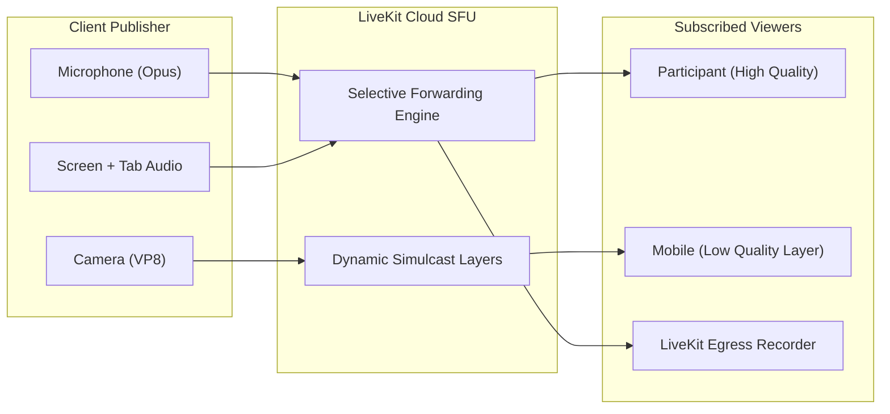

# Musica LiveKit SFU Integration Guide

> **Real-Time Media Plane Architecture**  
> Token Generation, Granular Publishing Permissions, Track Synchronization, and Recording.

---

## 1. LiveKit Architecture in Musica

Musica uses **LiveKit Cloud SFU** (`wss://musica-t6p6knyc.livekit.cloud`) as its dedicated media plane. The Selective Forwarding Unit routes audio, video, and screen sharing packets between participants using WebRTC without transcoding every stream.



---

## 2. Server-Side Token Generation

Tokens are generated by `server/src/services/LiveKitService.ts` using the official `livekit-server-sdk`.
Tokens are cryptographically signed with `LIVEKIT_API_KEY` and `LIVEKIT_API_SECRET` and are strictly short-lived (default: 6 hours).

```typescript
const at = new AccessToken(this.apiKey, this.apiSecret, {
  identity: participantIdentity,
  name: userName,
  ttl: '6h',
});

at.addGrant({
  room: roomId,
  roomJoin: true,
  canPublish: canPublishMedia,
  canSubscribe: true,
  canPublishData: true,
  canPublishSources: publishSources, // [TrackSource.MICROPHONE, TrackSource.CAMERA, TrackSource.SCREEN_SHARE]
});
```

---

## 3. Experience-Specific Permissions Matrix

Permissions are enforced at the SFU level via token grants, preventing unauthorized users from broadcasting media packets.

| Experience | Role | Audio Publish | Video Publish | Screen Share | Subscribe | Data Channels |
|---|---|:---:|:---:|:---:|:---:|:---:|
| **Private Room (1:1)** | Host & Peer | ✅ | ✅ | ✅ | ✅ | ✅ |
| **Podcast Studio** | Host / Co-Host | ✅ | ✅ | ✅ | ✅ | ✅ |
| | Speaker | ✅ | ✅ | ❌ | ✅ | ✅ |
| | Audience | ❌ | ❌ | ❌ | ✅ | ✅ |
| **Interactive Classroom** | Teacher | ✅ | ✅ | ✅ | ✅ | ✅ |
| | Student | ❌ (Unless Hand Raised) | ❌ | ❌ | ✅ | ✅ |
| **Remote Support** | Customer | ✅ | ❌ | ✅ (Screen) | ✅ | ✅ |
| | Technician | ✅ | ❌ | ❌ (Annotations only) | ✅ | ✅ |

> [!IMPORTANT]
> In **Private Room** and **Remote Support** sessions, both participants receive symmetric audio/screen publishing permissions upon joining, while in **Podcast** sessions, audience members are locked to subscribe-only mode until promoted.

---

## 4. Screen Sharing with Audio

Musica supports high-definition screen sharing with synchronized system/tab audio:
- **Resolution**: Adaptive up to 1080p at 30 or 60 fps.
- **Audio Routing**: Browser `getDisplayMedia({ audio: true, video: true })` captures system audio track, which LiveKit publishes as a dedicated audio track alongside the video track.
- **Remote Support Canvas**: Displays the incoming screen track inside an interactive canvas with coordinate scaling (`xRatio`, `yRatio`) for laser pointer guidance overlays.

---

## 5. LiveKit Egress & Recording Pipeline

For podcast sessions and classroom lectures, recordings are captured via LiveKit Egress:
1. **Trigger**: Host clicks "Start Recording" in the Studio Dock (`PODCAST_RECORDING_CHANGE`).
2. **Egress Service**: LiveKit spawns a headless browser worker in the cloud to capture room composite audio and video.
3. **Storage**: The rendered MP4 is uploaded directly to Supabase Storage or an S3 bucket.
4. **Metadata**: Recording duration, file size, and URL are stored in the `recordings` Supabase table (`007_recordings.sql`).
