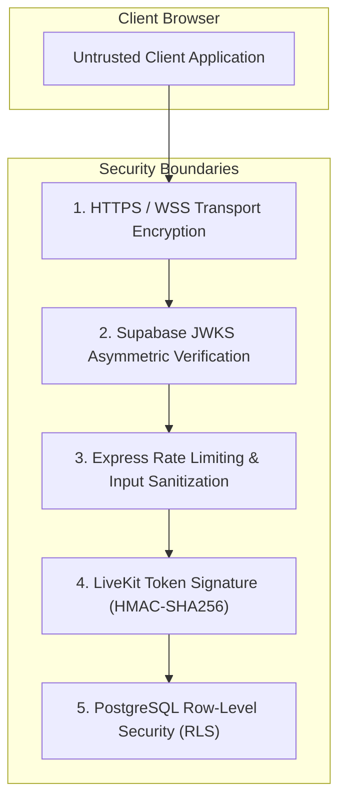
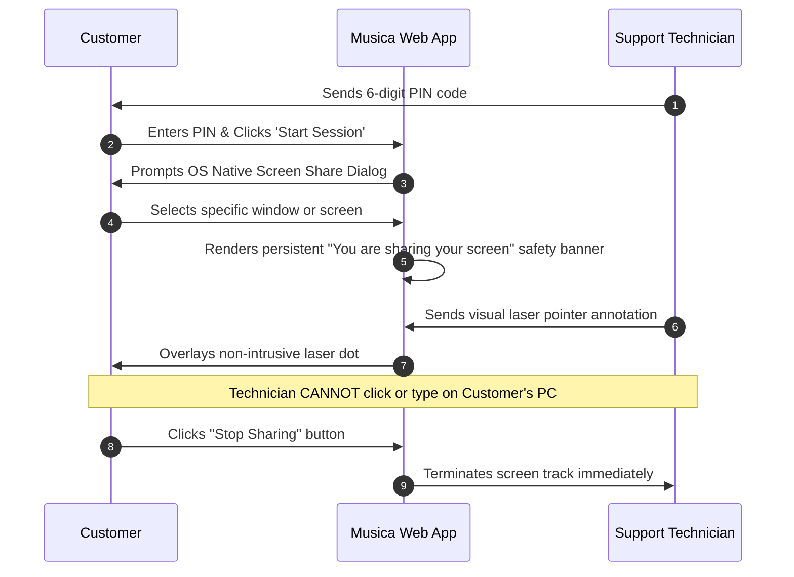

# Musica Security & Authorization Specification

> **Musica Security Architecture & Governance**  
> Threat Model, Asymmetric JWT Verification, RBAC Enforcement, and Data Privacy.

---

## 1. Security Architecture Principles

Musica enforces defense-in-depth across all three architectural planes:
1. **Zero-Trust Media Plane**: Media packets are transported exclusively over DTLS-SRTP encrypted WebRTC channels managed by the SFU.
2. **Server-Authoritative Control Plane**: No client can unilaterally grant itself elevated privileges. All room sizes, role transitions, and LiveKit tokens are issued exclusively by the Express backend.
3. **Row-Level Security (RLS) Data Plane**: Direct database queries are constrained by PostgreSQL RLS policies tied to the authenticated user's `auth.uid()`.

---

## 2. Authentication & Identity Verification

- **Supabase Auth**: Users authenticate via email/password or OAuth. Supabase issues asymmetric RS256 JWT tokens.
- **JWKS Key Rotation**: The Express API validates incoming Bearer tokens using `SUPABASE_JWKS_URL` (`https://ymzpafxyrmiaizxacmrx.supabase.co/auth/v1/.well-known/jwks.json`).
- **Host Session Secrets**: When a room is created, the server generates a cryptographically random `hostAuthToken` (`crypto.randomBytes(32).toString('hex')`). Only the user holding this secret can reclaim host privileges during network reconnections.

---

## 3. Remote Support Security & Privacy Controls

Remote support presents sensitive screen sharing workflows. Musica adheres to strict privacy safeguards:

1. **No Remote Control Injection**: Unlike traditional RDP or VNC, Musica Remote Support is strictly **view-and-guide**. The technician can only send overlay annotations (`SUPPORT_ANNOTATION_CREATE`); they have no OS access.
2. **Persistent Visual Indicator**: A prominent, non-dismissible safety banner displays throughout the session: *"You are sharing your screen. The technician can only view your display."*
3. **One-Click Instant Termination**: The customer can disconnect the screen stream at any moment with a single click, immediately invalidating the track.

---

## 4. Rate Limiting & Denial of Service Protection

- **API Throttling**: Express routes are protected with `express-rate-limit`. Room creation is capped at 10 requests per minute per IP.
- **Room Capacity Enforcement**: Server-authoritative checks in `RoomService.createRoom()` prevent exceeding room limits (e.g. `private` rooms are clamped to 2).
- **Socket Flooding Protection**: Socket.IO listeners discard malformed payloads and rate-limit chat and emoji spam.
