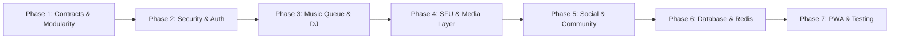

# Musica 2.0 — Technical Evolution Roadmap

**Target Version:** Musica 2.0  
**Methodology:** Incremental, non-destructive migration  
**Core Directive:** Preserve 100% of existing working features while introducing modular, scalable enterprise components.

---

## Roadmap Phases



---

### Phase 1: Shared Contracts & Store Modularization
- **Objective:** Establish strict shared TypeScript contracts for all 2.0 entities and partition frontend state.
- **Tasks:**
  - Expand `@musica/shared` with:
    - `QueueItem`, `Track`, `MusicProvider`, `DJSession`.
    - `PlaybackState` with sequence numbers and drift policies.
    - `UserProfile`, `Friend`, `DirectMessage`.
    - `LiveEvent` schemas.
  - Refactor client state into domain stores:
    - `stores/room.store.ts`
    - `stores/player.store.ts`
    - `stores/queue.store.ts`
    - `stores/chat.store.ts`
    - `stores/auth.store.ts`
    - `stores/media.store.ts`
  - Maintain backward compatibility with legacy `useRoomStore` through facade re-exports.

---

### Phase 2: Security, Authentication & Rate Limiting
- **Objective:** Secure HTTP and WebSocket attack vectors without breaking guest access.
- **Tasks:**
  - Password Hashing: Migrate room passwords from plaintext to salted cryptographic hashes (Argon2id/bcrypt).
  - Rate Limiting: Add Express rate-limiting on `/api/rooms`, `/api/rooms/join`, and socket event handlers.
  - Input Sanitization: Implement XSS protection and strict schema validation (Zod/Joi) on all HTTP and Socket.IO payloads.
  - User Authentication Service: Support both registered users (JWT / session cookies) and seamless guest joining.

---

### Phase 3: Collaborative Music Queue & DJ Mode
- **Objective:** Create a unified social listening environment with a shared queue and DJ console.
- **Tasks:**
  - Music Provider Interface:
    ```typescript
    interface MusicProvider {
      searchTracks(query: string): Promise<Track[]>;
      getTrack(trackId: string): Promise<Track | null>;
      getPlaylist(playlistId: string): Promise<Track[]>;
    }
    ```
  - Implement YouTube Music Provider (using YouTube IFrame API / Data API).
  - Implement Collaborative Queue: Add, remove, reorder, upvote, skip track, automatic next-track playback.
  - Dedicated DJ Console: Role assignment (Host $\rightarrow$ DJ), track announcement, request approval/denial, and audience voting.

---

### Phase 4: SFU Real-Time Media Layer (LiveKit + Mesh Fallback)
- **Objective:** Enable high-capacity rooms (100+ concurrent audio/video participants).
- **Tasks:**
  - Media Provider Abstraction (`MediaProvider` interface).
  - Implement `LiveKitMediaProvider` alongside existing `P2PMeshMediaProvider`.
  - Config-driven provider selection (`MEDIA_PROVIDER=livekit|mesh`).
  - Server-side LiveKit token generation and room webhook tracking.
  - Network resilience: ICE restart, packet loss telemetry, automated track recovery.

---

### Phase 5: Social Networking, Profiles & Direct Messaging
- **Objective:** Transform Musica from isolated rooms into a connected social ecosystem.
- **Tasks:**
  - User Profiles: Avatars, bio, favorite genres, public presence ("Listening in Room #Y3YP").
  - Friend System: Friend requests, accept/reject, online friends drawer, 1-click room invites.
  - Real-Time Direct Messaging: Private 1-on-1 text chat, read receipts, unread badges.

---

### Phase 6: Database & Redis Scale Architecture
- **Objective:** Graduate from atomic JSON files to production-grade distributed storage.
- **Tasks:**
  - PostgreSQL schema using Prisma ORM with normalized relations (`users`, `rooms`, `queue_items`, `events`).
  - Dual-mode data access layer: seamlessly reads/writes to JSON files in local standalone mode, or PostgreSQL in cloud mode.
  - Redis integration for real-time presence, distributed Socket.IO adapter, and transient playback state snapshots.

---

### Phase 7: PWA, Polishing & Automated Testing
- **Objective:** Commercial-grade reliability, installability, and UI/UX elegance.
- **Tasks:**
  - PWA: Web app manifest, service worker for asset caching, install prompt, safe-area CSS.
  - Premium Dark UI: Refined glassmorphism, responsive desktop sidebar, mobile bottom sheet navigation.
  - Testing Suite: Vitest for unit tests, Supertest for REST APIs, Playwright for end-to-end room/playback verification.
